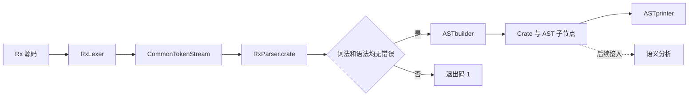

# AST 阶段框架设计

AST 模块使用 C++17，位于 `include/ast/` 和 `src/ast/`，命名空间为 `rx::AST`。它接收 ANTLR 生成的解析树，构造独立于 Parser 的抽象语法树，供遍历、调试和后续语义分析使用。

本文按当前代码说明节点模型、构建协议、语法归一化、访问方式和测试入口。后续名称解析、类型检查及结果保存方式见 [Semantic 阶段实施指南](semantic.md)；该指南中的接入计划不代表当前 AST driver 已实现相应功能。

## 1. 阶段边界与文件职责

### 1.1 从源码到 AST



当前 [main.cpp](../src/main.cpp) 先执行 `parser.crate()`，再检查 Lexer 和 Parser 的错误数；有错误时直接返回，不把 ANTLR 错误恢复产生的树交给 builder。通过后调用 `ASTbuilder::build`，再由 `ASTprinter` 输出 AST。

AST 阶段负责保留程序的语法结构，并消除后续阶段不需要的解析细节：

- 保留声明、类型语法、表达式、语句、操作符和源码中的列表顺序。
- 将多套表达式规则归一到相同节点，将括号分组落实为树的嵌套关系。
- 保留整数原始拼写、可变性、receiver、显式类型实参、derive 分组和分号信息。
- 把块内语句与尾表达式分开，区分“缺省”与显式 `()`。

名字是否存在、类型是否匹配、赋值目标是否可写、常量的值与范围、方法选择、跳转是否合法，都由后续语义阶段判断。AST builder 不做类型推导、常量折叠、借用检查，也不生成 IR。例如，`i32` 对应的 `PathType` 仍是类型语法，`AssignExpr` 的存在也不代表左侧已经通过可写性检查。

### 1.2 文件分工

| 文件 | 职责 |
| --- | --- |
| [grammar/Lexer.g4](../grammar/Lexer.g4) | 词法规则、整数拼写和多字符标点的拆分约定 |
| [grammar/Parser.g4](../grammar/Parser.g4) | 语法入口、优先级、结合性及条件/语句边界 |
| [include/ast/ast.hpp](../include/ast/ast.hpp) | 节点、枚举、辅助结构、指针别名和纯虚 `ASTvisitor` 接口；不依赖 ANTLR |
| [src/ast/ast.cpp](../src/ast/ast.cpp) | 节点种类、操作符、receiver 等枚举的字符串转换 |
| [include/ast/builder.hpp](../include/ast/builder.hpp) | ANTLR Visitor 适配、构建结果类型、临时 plan 和 builder 内部接口 |
| [src/ast/builder.cpp](../src/ast/builder.cpp) | 各语法规则到 AST 的转换、节点 ID 分配和归一化 |
| [include/ast/visitor.hpp](../include/ast/visitor.hpp)、[src/ast/visitor.cpp](../src/ast/visitor.cpp) | 默认递归遍历 `ASTwalker` 与文本输出 `ASTprinter` |
| [src/main.cpp](../src/main.cpp) | 文件读取、解析、错误检查、建树和打印 |
| [Makefile](../Makefile) | 生成 ANTLR C++ 文件，编译 driver 和 AST 模块 |
| [tests/custom/ast/probe.cpp](../tests/custom/ast/probe.cpp)、[scripts/test_ast.py](../scripts/test_ast.py) | 独立建树、结构检查、精确结构比较和回归测试 |

## 2. 节点模型与所有权

### 2.1 基类、身份和分派

所有节点继承 `ASTnode`，共同保存 `size_t id` 和 `const nodeKind kind`，并实现：

```cpp
virtual void accept(ASTvisitor& visitor) const = 0;
```

具体节点的 `accept` 调用 `visitor.visit(*this)`，将处理分派到具体类型的重载。`nodeKind` 则支持按枚举分支处理和调试输出；枚举必须与实际动态类型一致。当前共有 34 种具体节点：

| 类别 | 基类 / 层次 | 数量 |
| --- | --- | ---: |
| 根 | `Crate : ASTnode` | 1 |
| 声明 | `Itemnode`；其中 `AssociatedItem : Itemnode` 限定可放入 impl 的声明 | 4 |
| 类型语法 | `Typenode` | 4 |
| 语句 | `Stmtnode` | 3 |
| 表达式 | `Exprnode` | 22 |

`FunctionItem` 和 `ConstItem` 继承 `AssociatedItem`，既可出现在 `Crate::items`，也可出现在 `ImplItem::items`。`StructItem` 和 `ImplItem` 直接继承 `Itemnode`，不能放入关联声明列表。

每个新建的 `ASTbuilder` 从 ID 1 开始，通过 `nextId()` 为实际节点递增编号。`build()` 本身不重置计数器；ID 仅用于本次构建会话中的节点身份，不是源码位置，也不保证根为 1 或符合某种遍历顺序。不同 builder 的 ID 可以重复，不能直接当作跨文件、跨编译会话的全局身份。

### 2.2 shared_ptr 与树结构

节点通过 `shared_ptr` 保存子节点，常用别名包括 `Exprnode_ptr`、`Typenode_ptr`、`Stmtnode_ptr`、`Itemnode_ptr`、`AssociatedItem_ptr` 和 `Block_ptr`。`Crate_ptr` 及具体声明指针别名定义在 `builder.hpp`。

成功构建的结果按**树**使用：每个语法位置拥有自己的节点，不能让两个位置复用同一节点，也不能形成环。`shared_ptr` 提供内存所有权管理，不表示 AST 在语义上允许共享子树。相同拼写的两个类型出现位置仍有不同节点 ID，后续类型驻留由语义模块单独完成。

AST 中的字符串、容器和子节点都独立拥有数据，不保存 Token、ParserRuleContext 或 ParseTree 指针。只要保留 AST 根，销毁 Parser、Lexer 和 TokenStream 后仍可访问它。现有 probe 专门检查这一点。

节点字段多数是公开可写的；`accept` 的 `const` 接口也不等于整棵树在 C++ 类型系统中深度不可变。当前约定是在构建完成后把 AST 当作只读输入，语义结果通过节点 ID 存到独立结果表。

### 2.3 辅助结构

以下结构按值嵌入节点，没有自己的节点 ID，但其中的类型或表达式子节点有 ID：

| 结构 | 字段与含义 |
| --- | --- |
| `Identifier` | `std::string`，保存名字文本 |
| `Binding` | `name`、`mutability`；用于 let 和普通参数 |
| `PathSegment` | `kind`、`name`、`args`；区分普通名字、值 `self`、类型 `Self` |
| `Path` | `vector<PathSegment>`，按源码顺序保存路径段 |
| `GenericArguments` | `vector<Typenode_ptr>`，仅保留显式类型实参 |
| `Parameter` | `binding`、`type`；不包含 receiver |
| `FieldDeclaration` | 字段名和类型节点 |
| `FieldInitializer` | 字段名和初始化表达式 |
| `DeriveAttribute` | 一个 `vector<DeriveKind>`，对应一组 `#[derive(...)]` |

`Mutability` 只有 `Immutable` 与 `Mutable`。`Binding::mutability` 描述绑定本身，`RefType::mutability` 描述引用，两者不能混用。比如 `let mut x: &T = y;` 的绑定可变，引用仍是共享引用。

## 3. 节点字段与缺省约定

下表中的“可空”表示合法语法下可以缺省。其他子节点在 builder 成功后应当存在；构造函数或 walker 中的判空不能替代这个契约。

### 3.1 声明与类型语法

| 节点 | 主要字段 | 约定 |
| --- | --- | --- |
| `Crate` | `items` | 过滤 use 后的顶层声明，按源码顺序；允许空列表 |
| `FunctionItem` | `name`、`receiver`、`parameters`、`return_type`、`has_lifetime`、`body` | 返回类型可空；当前文法和 builder 要求函数体存在 |
| `StructItem` | `name`、`fields`、`derives` | 保存字段顺序及各组 derive 的顺序，不合并或生成派生实现 |
| `ConstItem` | `name`、`type`、`value` | 类型和值均必需；值仍是受限常量表达式的 AST |
| `ImplItem` | `target_type`、`items` | 目标类型必需；成员只能是函数和常量 |
| `UnitType` | 无附加字段 | 显式 `()` 类型 |
| `PathType` | `path` | 包括 `i32`、`bool`、`Self`、`Vec<T>` 等类型拼写，尚未解析 |
| `RefType` | `inner`、`mutability` | 每个节点只表示一层引用 |
| `ArrayType` | `element`、`length` | 长度是表达式节点，尚未求值 |

`FunctionItem` 的构造函数允许 `body == nullptr`，头文件也留有可空注释；但当前 `functionDefinition` 必须包含 `blockExpression`，builder 始终构造函数体，probe 也将其作为必需子节点。因此不能据此认为当前源码支持 `fn f();`。

没有 `-> ...` 时，`return_type == nullptr`，不会补造 `UnitType`；显式 `-> ()` 才有 `UnitType`。语义阶段再解释缺省返回类型。

receiver 独立保存，不混入普通参数列表：

| 语法 | `Receiver` |
| --- | --- |
| 无 receiver | `Null` |
| `self` | `Value` |
| `mut self` | `MutableValue` |
| `&self` | `SharedReference` |
| `&mut self` | `MutableReference` |

### 3.2 语句

| 节点 | 主要字段 | 约定 |
| --- | --- | --- |
| `EmptyStmt` | 无附加字段 | 一个独立的 `;`，不丢弃 |
| `LetStmt` | `binding`、`initializer`、`annotation` | 初始化表达式必需；类型注解可空 |
| `ExprStmt` | `expression`、`has_semicolon` | 表达式必需；无分号的非末尾块表达式仍可作为语句 |

当前 let 文法要求 `= expression`，因此 AST 中没有合法的“未初始化 let”。块尾表达式直接放在 `BlockExpr::tail`，不再包一层 `ExprStmt`。

### 3.3 表达式

| 节点 | 主要字段 | 约定 |
| --- | --- | --- |
| `IntLiteral` | `text`、`base`、`suffix` | 保留完整数字拼写，不保存已经计算的整数值 |
| `BoolLiteral` | `value` | `true` / `false` |
| `UnitExpr` | 无附加字段 | 显式 `()` 值，与 `UnitType` 分开 |
| `PathExpr` | `path` | 名字及路径段尚未绑定到声明 |
| `UnaryExpr` | `op`、`operand` | 负号、非、解引用和借用 |
| `BinaryExpr` | `op`、`left`、`right` | 算术、移位、位运算、比较、逻辑运算 |
| `AssignExpr` | `op`、`target`、`value` | 普通及复合赋值，保留独立节点 |
| `CastExpr` | `value`、`target_type` | 显式 `as` 转换 |
| `CallExpr` | `callee`、`arguments` | callee 是表达式；参数按源码顺序 |
| `MethodCallExpr` | `receiver`、`method`、`arguments` | method 是含类型实参的 `PathSegment` |
| `FieldExpr` | `base`、`field` | 字段访问，字段保存名字 |
| `IndexExpr` | `base`、`index` | 索引访问 |
| `ArrayExpr` | `elements` | 普通数组，允许空列表 |
| `ArrayRepeatExpr` | `value`、`count` | 重复数组，不展开复制 value 子树 |
| `StructExpr` | `path`、`fields` | 构造路径及源码顺序的字段初始化；`S {}` 与路径 `S` 不同 |
| `BlockExpr` | `statements`、`tail` | tail 可空；语句列表不含尾表达式 |
| `IfExpr` | `condition`、`then_branch`、`else_branch` | then 必须是块；else 可空，存在时只能是块或另一个 `IfExpr` |
| `WhileExpr` | `condition`、`body` | body 是块 |
| `LoopExpr` | `body` | body 是块 |
| `BreakExpr`、`ReturnExpr` | `value` | 操作数可空，不在此绑定跳转目标 |
| `ContinueExpr` | 无附加字段 | 不在此检查循环上下文 |

`BinaryOp::LogicalAnd` / `LogicalOr` 保留短路操作的身份，但 ASTwalker 会遍历两侧；遍历行为不是程序求值行为。复合赋值也不改写为普通二元运算加赋值，以便后续阶段正确处理目标位置及其求值次数。

## 4. ASTbuilder 的构建协议

### 4.1 ANTLR Visitor 与 std::any

`ASTbuilder` 继承生成的 `rx::RxParserBaseVisitor`。ANTLR 的规则访问接口返回 `std::any`，builder 用 `take<T>(node)` 调用 `visit(node)` 并精确取出结果：

```cpp
template<class T>
T take(antlr4::tree::ParseTree* node) {
    return std::any_cast<T>(visit(node));
}
```

`std::any_cast` 不会自动把 `shared_ptr<Derived>` 转成 `shared_ptr<Base>`。每个 visit 方法必须遵守调用方约定的**确切返回类型**，不能因为对象可向上转型，就直接把具体指针存入 any。

| 规则 / 辅助入口 | any 中的结果类型 |
| --- | --- |
| `crate` | `Crate_ptr`；`build` 取出该指针并直接返回 |
| `item` | `Itemnode_ptr`；use 对应空指针 |
| `functionDefinition`、`structDefinition`、`constantItem`、`inherentImpl` | 分别为 `Function_ptr`、`Struct_ptr`、`Const_ptr`、`Impl_ptr` |
| `associatedItem` | `AssociatedItem_ptr` |
| `typeRef`、`referenceType`、`arrayType`、`closedCastType` | `Typenode_ptr` |
| `blockExpression` | `Block_ptr` |
| 普通、条件、语句表达式及其各优先级规则 | `Exprnode_ptr` |
| `statement`、`letStatement` | `Stmtnode_ptr` |
| `functionParameters` | `FunctionParametersResult`：receiver 与普通参数 |
| 路径、绑定、字段、实参列表规则 | 相应的 `Path`、`PathSegment`、`Binding`、字段结构或 vector |
| `unaryOperator` | `UnaryOperatorPlan`，即 `vector<UnaryOp>` |
| `postfixSuffix`、`dotSuffix` | `PostfixPlan`，即四种后缀结构的 variant |
| 二元 / 赋值操作符规则 | `BinaryOp` / `AssignOp` |
| 显式忽略的规则 | `Ignored`；部分过滤入口使用相应类型的空指针 |

例如 `visitBlockExpression` 返回 `Block_ptr`；把块放进表达式位置时，`visitExpressionWithBlock` 显式构造 `Exprnode_ptr{block(...)}`。`expr()`、`type()`、`block()`、`stmt()` 分别封装这些不同的取值协议。

### 4.2 通用构建操作

| 内部函数 | 输入与职责 |
| --- | --- |
| `nextId` | 分配下一个节点身份 |
| `foldBinary` | 按解析树 children 中交替出现的“操作数、操作符、操作数”做左折叠 |
| `buildComparison` | 无比较时透传左侧，有比较时创建一个 `BinaryExpr` |
| `applyUnary` | 把一组从外到内排列的前缀操作倒序包到操作数外 |
| `applyReference` | 构造一层引用；遇到 `&&` 时再包一层共享引用 |
| `applySuffix` | 将一次 call、index、field 或 method 后缀接到已有 base 上 |
| `makeInteger` | 从原始拼写识别进制和后缀，创建 `IntLiteral` |

这些函数依赖文法的具体形状。例如 `foldBinary` 使用 `ctx->children` 保持不同操作符交错出现的顺序，既处理 Terminal 操作符，也处理返回 `BinaryOp` 的子规则。修改文法时，需要同步核对这些假设。

### 4.3 不允许隐式遗漏规则

builder 覆盖了 `visitChildren`，不会继承 BaseVisitor 的默认聚合结果；`visitTerminal` 返回 `Ignored`，无语义内容的文法规则也显式忽略。这样，节点构造依赖明确的规则分派。

当前 `visitChildren`、`visitErrorNode` 以及 `binaryToken` 的未识别分支使用裸 `throw;`。在没有正在处理的异常时进入这些分支会终止进程，不能当作正常的语法拒绝机制。调用方必须先检查解析错误；新增规则也必须补齐 builder 分派。若后续完善诊断，应将这些内部失败改为明确的实现错误，并与源码的词法/语法错误分开。

## 5. 表达式归一化

### 5.1 四套文法，一套 AST

Parser 为消除语法边界歧义提供四套表达式入口，builder 将它们构造成相同的表达式节点：

| 入口族 | 语法用途 | AST 构建方式 |
| --- | --- | --- |
| `expression` | 普通值表达式 | 对应优先级规则逐层构造 |
| `conditionExpression` | if / while 条件；限制没有定界符包围的结构体构造 | 复用二元折叠、比较、cast、一元和后缀构造 |
| `conditionBreakExpression` | 条件中的 break 操作数；起始 primary 不能是裸块 | 保留 Parser 对操作数边界的选择 |
| `statementExpression` | 块中的语句起始位置；块开头的表达式通过点后缀继续 | 先处理起始限制，再构造普通表达式节点 |

条件中的括号、调用实参、索引、数组和块体使用自身定界范围内的表达式规则，因此不能把条件入口的限制机械地施加到所有后代节点。

builder 不创建 `ConditionExpr`、`StatementExpression` 或 `ClosedExpr` 之类的包装节点。解析上下文的区别在建树时消失，后续语义检查读取统一结构。

### 5.2 优先级与结合性

以下为普通运算层次，从低到高排列；具体能否出现在条件或语句边界，仍由对应文法决定：

| 层次 | 操作 | 构建规则 |
| --- | --- | --- |
| 赋值 | `=`、`+=` 等 | 右侧递归，右结合 |
| 逻辑或 | `\|\|` | 左折叠 |
| 逻辑与 | `&&` | 左折叠 |
| 比较 | `==`、`!=`、`<`、`<=`、`>`、`>=` | 当前层最多一次比较，不构造无括号的比较链 |
| 位或 / 位异或 / 位与 | `\|` / `^` / `&` | 三层分别左折叠 |
| 移位 | `<<`、`>>` | 按源码顺序左折叠 |
| 加减 | `+`、`-` | 左折叠 |
| 乘除余 | `*`、`/`、`%` | 左折叠 |
| 转换 | `as` | 连续转换从左向右包裹 |
| 前缀 | `-`、`!`、`*`、`&`、`&mut` | 递归处理操作数，再包外层操作 |
| 后缀 | 调用、索引、字段、方法 | 从左向右接到已有 base 上 |

用省略 ID 的结构表示：

```text
a - b - c       → Binary(Subtract, Binary(Subtract, a, b), c)
a + b * c       → Binary(Add, a, Binary(Multiply, b, c))
a = b = c       → Assign(Assign, a, Assign(Assign, b, c))
x as i32 as u32 → Cast(Cast(x, i32), u32)
```

这些 `Binary` / `Assign` / `Cast` 是示意简写，分别对应 `BinaryExpr`、`AssignExpr` 和 `CastExpr`，不是新增节点类型。

### 5.3 closed 规则与右尖括号

`closed*` 规则用于限制 `<` / `<<` 前最后一个 cast 的目标类型。裸类型路径后的 `<` 可能被解释成类型实参的开始；括号类型、数组类型或已经闭合的泛型类型则提供明确边界。因此 `x as (T) < y`、`x as Vec<i32> << y` 都能构造成普通的 cast 加比较/移位节点，AST 无需保存 closed 标记。

Lexer 将 `>`、`>=`、`>>`、`>>=` 的组成部分按模式发出 `GT`、`GT_SECOND`、`GE_EQ`、`SHR_EQ` 等 token；Parser 的 `genericClose`、`shiftRight`、`comparisonExceptLt`、`equalsSign` 和 `assignmentOperator` 负责解释完整上下文。builder 只转换已识别的操作符，不能按字符串重新组合任意相邻 token。

例如 `let x: Vec<Vec<i32>>=y;` 中的两个 `>` 用于闭合类型实参，剩余 `=` 是初始化符；这里不产生右移赋值节点。

### 5.4 一元操作、双引用与后缀

`UnaryOperatorPlan` 按“外层到内层”保存操作符，`applyUnary` 倒序应用。`&&mut x` 的 plan 为 `[BorrowShared, BorrowMutable]`，结果为：

```text
UnaryExpr(BorrowShared)
└── UnaryExpr(BorrowMutable)
    └── PathExpr(x)
```

类型中的 `&&'a mut T` 同样展开成外层共享 `RefType` 和内层可变 `RefType`。生命周期不进入引用节点；`mut` 只作用于内层。

`PostfixPlan` 暂存后缀自己的信息，之后由 `applySuffix(base, suffix)` 创建最终节点。四个分支为 `CallSuffix`、`IndexSuffix`、`FieldSuffix` 和 `MethodSuffix`。例如 `a.b::<T>(1)[i].c` 依次构造成方法调用、索引、字段访问，最终根是 `FieldExpr`。

`a.b()` 直接生成 `MethodCallExpr`；`(a.b)()` 则生成以 `FieldExpr` 为 callee 的 `CallExpr`。即使括号节点被消除，Parser 已确定的这种语法差异仍通过不同树形保留下来。

## 6. 块、尾表达式与控制流

### 6.1 尾表达式的提取

文法中的块为 `LBRACE statement* statementExpression? RBRACE`。但最后一个无分号的块表达式可能被 Parser 放在 `statement*` 中，因此 `visitBlockExpression` 额外执行一次归一化：

1. 取得语句列表和显式的 `statementExpression` 尾部。
2. 若没有显式尾部，且最后一个 statement 是无分号的 `expressionWithBlock`，将它从语句列表中移出，作为尾表达式。
3. 按顺序构造剩余 statements，再构造 tail，最后创建 `BlockExpr`。

只检查最后一条语句，不越过分号或其他语句寻找尾部。

| 源码 | `statements` | `tail` |
| --- | --- | --- |
| `{}` | 空 | 空 |
| `{ 1 }` | 空 | `IntLiteral(1)` |
| `{ 1; }` | `ExprStmt(1, true)` | 空 |
| `{ () }` | 空 | `UnitExpr` |
| `{ { 1 } }` | 空 | 内层 `BlockExpr` |
| `{ { 1 }; }` | `ExprStmt(内层块, true)` | 空 |
| `{ { 1 } 2 }` | `ExprStmt(内层块, false)` | `IntLiteral(2)` |
| `{ ; }` | `EmptyStmt` | 空 |
| `{ if p { 1 } else { 2 } }` | 空 | `IfExpr` |

`tail == nullptr` 表示没有尾表达式，`tail` 指向 `UnitExpr` 表示存在显式 `()`，两者保留不同语法信息。块是否能正常完成、尾部是否可达以及最终类型是什么，由语义阶段确定。

### 6.2 控制流仍以表达式保存

`if`、`while`、`loop`、`break`、`return`、`continue` 都属于 `Exprnode`。`else if` 保存为 `IfExpr::else_branch` 指向另一个 `IfExpr`，不额外包装块。带值和不带值的 break / return 分别由非空和空 `value` 表示。

builder 忠实保留 Parser 的分组，不按预期语义重新解释。例如现有文法将 `if break a << b {}` 的条件分为 `(break a) << b`，而 `if break (a << b) {}` 将移位放入 break 的操作数；右移同理。结构测试同时记录这两类情况，必要时通过 probe 的 `--tree` 对照原始解析树。

## 7. 保留与丢弃的信息

### 7.1 字面量和受限常量

`makeInteger` 保存完整 `text`，识别二、八、十、十六进制，以及 `None`、`I32`、`U32`、`ISize`、`USize` 后缀。例如 `0xF_Fi32` 保存为 `text = "0xF_Fi32"`、`base = Hex`、`suffix = I32`。下划线、前缀和后缀都保留在 text 中。

负整数表示为 `UnaryExpr(Negate, IntLiteral(...))`，负号不属于整数字面量文本。AST 阶段不把幅值转换为宿主整数，也不提前判断溢出，因此 `-2147483648i32` 等边界情况可以交给后续语义规则统一处理。

常量声明值、数组类型长度、重复数组次数使用文法中的 `constValue`，其内容为整数、布尔、路径、受限负号或括号包围的同类形式；不是任意算术表达式。它们复用普通表达式节点，无额外 `ConstExpr` 包装。builder 只保留结构，不验证路径一定指向常量，也不计算数组长度。

### 7.2 路径、生命周期和声明修饰

| 源码信息 | 当前 AST 策略 |
| --- | --- |
| 类型路径 `Vec<T>`、表达式路径 `Vec::<T>` | 统一为 `PathSegment::args` 中的类型节点 |
| 路径中的 `self` 与 `Self` | 用 `PathSegmentKind::SelfValue` / `SelfType` 区分，名字文本也保留 |
| 普通表达式/类型括号 | 直接返回内部节点，分组效果保留在树形中 |
| 空括号 `()` | 依上下文创建 `UnitExpr` 或 `UnitType` |
| 类型实参列表中的生命周期 | `visitGenericArg` 返回空 `Typenode_ptr`，外层列表过滤；类型实参的相对顺序不变 |
| 引用和 receiver 上的生命周期 | 不保存名字；引用层数、可变性和 receiver 形式保留 |
| 函数声明的生命周期形参 | 仅保存 `FunctionItem::has_lifetime`，不保存名字或 bounds |
| struct / impl 的生命周期形参、where 子句 | 不进入 AST |
| `#[derive(...)]` | 保存每组 `Copy`、`Clone`、`PartialEq`、`Eq` 枚举，不做能力检查或实现生成 |
| `use` | `visitItem` 返回空 `Itemnode_ptr`，`visitCrate` 过滤；没有导入节点或导入表 |
| 注释、空白和多数分隔标点 | 不生成 AST 节点 |

`has_lifetime` 的判断非常具体：函数的 `genericParams` 中存在至少一个 `lifetimeParam` 才为 true。仅在参数类型中出现生命周期，或者存在空的 `<>`，都不会把该标记设为 true。这个字段也不代表完成了生命周期检查。

当前泛型形参文法只接收生命周期形参；类型实参节点的存在不能解释为已经支持用户自定义的一般类型泛型。当前 AST 没有源码范围字段，也没有 NodeId 到源码位置的映射；后续若需要精确诊断，应在前端适配层建立并保存相应信息。

## 8. ASTvisitor、ASTwalker 与 ASTprinter

这套接口访问的是已建成的 AST，与 `RxParserBaseVisitor` 访问解析树的职责不同：

- `ASTvisitor` 是纯虚接口，为全部具体节点声明 `visit(const T&)`。
- `ASTwalker` 为各节点实现默认的子节点递归，叶节点不做操作。
- `ASTprinter` 继承 walker，打印节点名、ID、字段和缩进层次；部分节点复用 walker，部分自行组织子节点输出。

walker 会遍历嵌在辅助结构里的节点，包括路径段的类型实参、方法的类型实参、参数类型、结构体字段类型和字段初始化值。只遍历显眼的表达式指针会漏掉这些节点。

扩展一次普通的结构访问，可以只覆盖关心的节点，并调用基类保留递归：

```cpp
class CallCounter : public rx::AST::ASTwalker {
public:
    std::size_t calls = 0;

    void visit(const rx::AST::CallExpr& node) override {
        ++calls;
        rx::AST::ASTwalker::visit(node);
    }
};
```

这个例子只统计普通 `CallExpr`；需要统计点方法调用时，还应覆盖 `MethodCallExpr`。若覆盖后不调用基类，就需要自行处理所有相关子节点。

walker 是结构遍历，不处理作用域、短路、不可达分支或运行时求值顺序。例如其 `LetStmt` 实现先访问 initializer，再访问 annotation；printer 则先显示 annotation。需要类型上下文或名字环境的语义检查应显式安排自己的顺序。

当前 printer 直接写入 `std::cout`，用于人工检查，不是稳定的序列化协议。新增的 `FunctionItem::has_lifetime` 尚未在 printer 中显示，也未进入现有 probe 的 JSON 字段；不能用打印或现有结构快照确认该字段已被验证。

## 9. 构建、运行与验证

### 9.1 当前 driver 入口

在项目根目录运行：

```sh
make build
make run SOURCE=path/to/program.rx
# 或在构建后直接调用
./.antlr/rx-compiler path/to/program.rx
```

构建依赖 ANTLR 命令、ANTLR C++ runtime 和支持 C++17 的编译器。Makefile 默认使用 `clang++`、`antlr`，runtime 前缀为 `/opt/homebrew/opt/antlr4-cpp-runtime`，可通过 `CXX`、`ANTLR`、`ANTLR4_RUNTIME_PREFIX` 等变量覆盖。

`make generate` 将原始文法复制为 `RxLexer.g4` / `RxParser.g4`，避免名字与运行库冲突，再以 `-Dlanguage=Cpp -visitor -no-listener -package rx` 生成到 `.antlr/generated/`。应修改 `grammar/` 下的原始文件，不手工维护生成文件。

当前 driver 只接收一个源文件路径：成功打印 AST 后返回 0，检测到词法或语法错误返回 1，参数数量不对或文件打不开返回 2。builder 的内部异常或终止不属于这组正常返回约定。当前没有 `--stage` 或 `--dump-ast` 参数，也尚未调用语义分析。

### 9.2 独立 AST 测试

```sh
python3 scripts/test_ast.py
# 可调整测试并发数，默认 4
python3 scripts/test_ast.py --jobs 4
```

脚本通过项目 Makefile 与 [tests/custom/ast/Makefile](../tests/custom/ast/Makefile) 构建独立 probe，复用当前 AST 源码、编译选项和运行库配置。测试分三组：

| 组 | 验证内容 |
| --- | --- |
| `official-parser` | 按 manifest 的入口解析 crate、item、typeRef、expression 或 letStatement；正例建树成功，负例必须正常报告词法/语法错误 |
| `official-program` | 复用 semantic、codegen、optimization 的合法程序并按源码内容去重；只检查建树，不判定语义或运行输出 |
| `structure` | 比较专门设计的预期树，覆盖优先级、结合性、四套表达式、后缀、块尾、引用、类型实参和声明 |

probe 会要求完整消费输入，检查非法词法 token；在销毁 ANTLR 对象后读取 AST，并验证节点 ID 非零且不重复、kind 与动态类型一致、路径非空、必需子节点存在及 else 分支种类正确。结构比较忽略具体 ID 数值，比较 probe 已输出的字段。新增字段需要同步扩展序列化和预期结果，现有测试不会自动覆盖它。

报告写入 `target/ast-tests/report.md`、`results.json` 和 `build.log`，生成的结构用例位于 `target/ast-tests/cases/`。单例复现：

```sh
target/ast-tests/ast-probe expression \
  target/ast-tests/cases/left-associative-subtraction.rx --tree
```

`--tree` 额外输出原始 ANTLR 解析树，用来区分 Parser 分组和 builder 转换。probe 的退出码 0 表示成功，1 表示词法/语法拒绝，捕获到的构建/结构异常返回 2；脚本将崩溃、异常和超时视为失败。访问到的文法规则数用于观察覆盖范围，不是分支覆盖率。

现有 `make test` 跳过 lex / parse 阶段，且 [config.mk](../config.mk) 仍配置 Rust 参考实现，不能替代这套 AST 测试。当前主 Makefile 的 `CPP_SOURCES` 也只包含 `src/main.cpp` 与 `src/ast/*.cpp`，尚未将 semantic 模块接入编译。

## 10. 扩展时需要保持的契约

新增一个节点或语法分支时，应按依赖顺序同步：

1. 调整原始文法并重新生成 Parser，确认解析树的边界和结合性。
2. 在 `ast.hpp` 中补节点、`nodeKind`、前置声明和 `ASTvisitor::visit`；在 `ast.cpp` 中补枚举显示。
3. 在 builder 中补规则返回协议及构造逻辑，明确必需字段、可空字段和归一化策略。
4. 为 walker 和 printer 补访问逻辑，覆盖辅助结构中嵌入的类型和表达式节点。
5. 为 probe 和结构用例补字段检查、树形预期及必要反例，再运行 AST 测试。
6. 若改变 AST 交给后续阶段的信息，同步语义输入契约；新增源码定位或语义结果应有明确归属。

交付给语义阶段的 AST 应满足：ID 非零且在树内唯一，kind 与动态类型一致，必需子节点非空，列表顺序保留，尾表达式只出现一次，整数拼写完整，并且不依赖 ANTLR 对象的生存期。语义合法性则由后续阶段独立判断。
